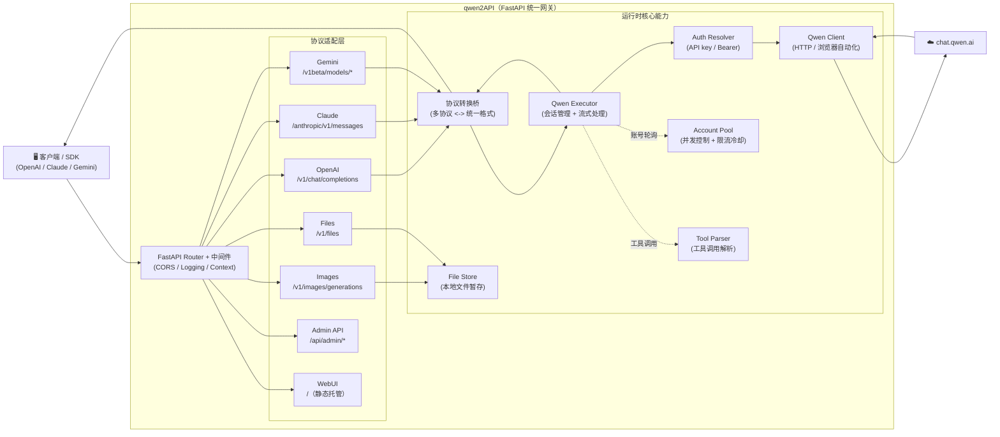

# qwen2API Enterprise Gateway

[](https://github.com/sofs2005/qwen2API/blob/main/LICENSE)
[](https://github.com/sofs2005/qwen2API/stargazers)
[](https://github.com/sofs2005/qwen2API/network/members)
[](https://github.com/sofs2005/qwen2API/releases)
[](https://github.com/sofs2005/qwen2API/pkgs/container/q2a)

[](https://zeabur.com/templates/qwen2api)
[](https://vercel.com/new/clone?repository-url=https%3A%2F%2Fgithub.com%2Fsofs2005%2Fqwen2API)

语言 / Language: [中文](./README.md) | [English](./README.en.md)

qwen2API 用于将通义千问（chat.qwen.ai）网页版能力转换为 OpenAI、Anthropic Claude 与 Gemini 兼容接口。项目后端基于 FastAPI，前端基于 React + Vite，内置管理台、账号池、工具调用解析、图片生成链路与多种部署方式。

原始项目作者：YuJunZhiXue；当前仓库由 sofs2005 维护。

---

## 目录

- [项目说明](#项目说明)
- [架构概览](#架构概览)
- [核心能力](#核心能力)
- [接口支持](#接口支持)
- [模型映射](#模型映射)
- [图片生成](#图片生成)
- [多模态输入（图片 / 音频 / 视频）](#多模态输入图片--音频--视频)
  - [浏览器上传代理（突破 6KB 内联上限）](#浏览器上传代理突破-6kb-内联上限)
- [快速开始](#快速开始)
  - [方式一：Docker 直接运行预构建镜像（推荐）](#方式一docker-直接运行预构建镜像推荐)
  - [方式二：本地源码运行](#方式二本地源码运行)
- [环境变量说明（.env）](#环境变量说明env)
- [docker-compose.yml 说明](#docker-composeyml-说明)
- [端口说明](#端口说明)
- [WebUI 管理台](#webui-管理台)
- [数据持久化](#数据持久化)
- [常见问题](#常见问题)
- [许可证与免责声明](#许可证与免责声明)

---

## 项目说明

本项目提供以下能力：

1. 将千问网页对话能力转换为 OpenAI Chat Completions 接口。
2. 将千问网页对话能力转换为 Anthropic Messages 接口。
3. 将千问网页对话能力转换为 Gemini GenerateContent 接口。
4. 提供独立的图片生成接口 `POST /v1/images/generations`。
5. 支持工具调用（Tool Calling）与工具结果回传。
6. 提供管理台，用于账号管理、API Key 管理、图片生成测试与运行状态查看。
7. 提供多账号轮询、限流冷却、重试与按需浏览器自动化能力。

---

## 架构概览



**架构说明**：

- **后端**：Python FastAPI（`backend/`），统一处理多协议适配与上游调用
- **前端**：React 管理台（`frontend/`），运行时托管静态构建产物
- **部署**：Docker（推荐）、本地运行、Vercel、Zeabur

**核心特性**：

- **统一路由内核**：所有协议入口统一汇聚到 FastAPI Router，避免多入口行为漂移
- **协议转换桥**：Claude / Gemini 入口先转换为统一格式，再调用上游，最后转换回原协议响应
- **工具调用支持**：支持 OpenAI / Claude / Gemini 三种工具调用格式，自动解析与转换
- **账号池管理**：多账号轮询、并发控制、限流冷却、自动重试
- **文件附件**：支持文件上传、本地暂存、上下文注入
- **图片生成**：独立图片生成接口，支持多种尺寸比例

---

## 核心能力

- OpenAI / Anthropic / Gemini 三套接口兼容。
- 工具调用解析与工具结果回传。
- 默认请求链路走直连 HTTP；注册、激活、刷新 Token 时按需启用浏览器自动化。
- 多账号并发池、动态冷却、故障重试。
- 基于千问网页真实工具链路的图片生成。
- 多模态输入：图片 / 音频 / 视频附件（≤6KB 走 data URI 内联；更大的走浏览器上传代理换 STS 后直传 OSS）。
- WebUI 管理台。
- 健康检查与就绪检查接口。

---

## 接口支持

| 接口类型 | 路径 | 说明 |
|---|---|---|
| OpenAI Chat | `POST /v1/chat/completions` | 支持流式与非流式、工具调用、图片意图自动识别 |
| OpenAI Models | `GET /v1/models` | 返回可用模型别名 |
| OpenAI Images | `POST /v1/images/generations` | 图片生成接口 |
| Anthropic Messages | `POST /anthropic/v1/messages` | Claude / Anthropic SDK 兼容 |
| Gemini GenerateContent | `POST /v1beta/models/{model}:generateContent` | Gemini SDK 兼容 |
| Gemini Stream | `POST /v1beta/models/{model}:streamGenerateContent` | 流式输出 |
| Admin API | `/api/admin/*` | 管理接口 |
| Health | `/healthz` | 存活探针 |
| Ready | `/readyz` | 就绪探针 |

---

## 模型映射

当前只提供两个稳定短别名，实际调用的上游模型由环境变量控制：

| 传入模型名 | 默认实际调用 | 配置变量 |
|---|---|---|
| `qwen-max` | `qwen3.8-max` | `QWEN_MAX_MODEL` |
| `qwen-plus` | `qwen3.7-plus` | `QWEN_PLUS_MODEL` |

未命中映射表时，默认回退为传入模型名本身；若管理台设置了自定义映射规则，则以运行时配置为准。

预热模型默认跟随这两个别名的当前目标。也可以通过 `CHAT_ID_PREWARM_MODELS` 传入逗号分隔的模型名；其中的短别名会先按同一套映射解析，显式设为空可关闭默认模型预热。

---

## 图片生成

qwen2API 提供与 OpenAI Images 接口兼容的图片生成能力。

- 接口：`POST /v1/images/generations`
- 默认模型：由环境变量 `IMAGE_GENERATION_MODEL` 控制（默认 `qwen3.8-max`；不再使用 `dall-e-*` 别名）。
- 实际链路：走千问网页**原生 t2i 通道**（`chat_type` / `sub_chat_type` / `extra.meta.subChatType` 均为 `t2i`，顶层带 `size`）→ CDN 回源转存 → 同源 `/v1/images/content/{id}`
  - t2i 一轮未取到图片时自动回退到旧的 t2t 提示词诱导路径（日志 `[T2I] 原生 t2i 未取到图片，回退 t2t 提示词诱导路径`）
  - 图片 URL 兜底顺序：SSE 事件 → `GET /api/v2/library/list` → 当前 chat 详情
- `extra.meta.model`：由 `IMAGE_GENERATION_META_MODEL` 控制，留空则不发送该键（出图模型由上面的 chat 级 `model` 决定）
- 返回：本地托管图片 URL（避免 `cdn.qwenlm.ai` 签名链在浏览器 403）
- 缩略图：`GET /v1/images/content/{id}?w=480` 返回该宽度的 JPEG（按 id+宽度落盘缓存，`Cache-Control: 86400`）。原图常见 5~10MB，媒体库网格用缩略图；Pillow 缺失或渲染失败时**静默退回原图**，不带 `w` 的行为完全不变
- 生图本地缓存 TTL：`GENERATED_MEDIA_TTL_SECONDS`（默认 `0` = 永久保留，供媒体库长期展示；设为正数则到期清理）

### 请求示例

```bash
curl http://127.0.0.1:7860/v1/images/generations \
  -H "Content-Type: application/json" \
  -H "Authorization: Bearer YOUR_API_KEY" \
  -d '{
    "model": "qwen3.8-max",
    "prompt": "一只赛博朋克风格的猫，霓虹灯背景，超写实",
    "n": 1,
    "size": "1024x1024",
    "response_format": "url"
  }'
```

### 返回示例

```json
{
  "created": 1712345678,
  "data": [
    {
      "url": "https://cdn.qwenlm.ai/output/.../image.png?key=...",
      "revised_prompt": "一只赛博朋克风格的猫，霓虹灯背景，超写实"
    }
  ]
}
```

### 支持的图片比例

前端图片生成页面内置以下比例：

- `1:1`
- `16:9`
- `9:16`
- `4:3`
- `3:4`

`size` 除上述比例外还接受 OpenAI 风格的像素值（如 `1024x1024`、`1280x720`），会按固定映射表归一为对应比例；留空或无法识别时用上游默认的 `auto`。

### Chat 接口图片意图识别

`/v1/chat/completions` 支持根据用户消息自动识别图片生成意图。例如：

- “帮我画一张……”
- “生成一张图片……”
- “draw an image of ……”

当识别为图片生成请求时，系统会自动切换到图片生成管道。

---

## 视频生成

qwen2API 同时提供 OpenAI Videos 风格的视频生成能力（底层走千问网页的 `t2v` 通道）。

- 接口：`POST /v1/videos/generations`（同义路径 `/videos/generations`）
- 异步任务：聊天流只产出 `task_id`，服务端轮询 `GET /api/v1/tasks/status/{task_id}` 直到完成，最长约 7 分钟
- **视频回源落盘**：上游 CDN 直链带签名会过期，因此拿到 URL 后会回源下载并转存到本地，对外返回同源 `/v1/videos/content/{id}`（`n>1` 时多条结果复用同一个落盘文件）
  - 回源失败（下载异常 / 空响应 / 超出 `GENERATED_VIDEO_MAX_BYTES`）时**不会让生成失败**，自动退回原始 CDN 直链
  - 内容接口使用 `Content-Disposition: inline` 且不传 filename，浏览器 `<video>` 可直接内联播放；支持 HTTP Range（拖动进度条）
- 生成物保留时长：`GENERATED_MEDIA_TTL_SECONDS`（默认 `0` = 永久保留）

### 媒体库接口（后台）

图片与视频生成物统一进「媒体库」，需管理凭证（`Authorization: Bearer <ADMIN_KEY 或任一 API Key>`）。
控制台侧对应页面是 **`/media`**（侧栏「生成工作台 → 媒体库」）：按类型 / 生成时间 / 体积 / 排序筛选，
按提示词搜索，网格预览（图片走 `?w=` 缩略图），点开全屏查看，支持**全选（含未加载的跨页条目）/ 反选 /
清空选择**后批量删除，也可单条删除。

| 方法 | 路径 | 说明 |
|---|---|---|
| `GET` | `/api/admin/media` | 列表。查询参数：`kind`（`all`/`image`/`video`）、`q`（对 prompt / 文件名 / 比例做大小写不敏感搜索）、`since_days`（只返回最近 N 天，`0`=不限）、`min_size`（体积下限，字节，`0`=不限）、`sort`（`newest` / `oldest` / `largest`）、`limit`（1..100，默认 24）、`offset`。返回 `items`/`total`/`offset`/`limit`/`has_more`/`stats`（`image`/`video`/`bytes`；**只忽略类型维度**，其它筛选照常生效） |
| `DELETE` | `/api/admin/media/{file_id}` | 删除单个生成物（元数据 + 磁盘文件）；不存在或非生成物返回 404 |
| `POST` | `/api/admin/media/delete` | 批量删除，body `{"ids": [...]}`，返回 `deleted` 数量与 `ids`/`missing` 两组 id |

列表项形如：

```json
{
  "id": "3f2a...",
  "kind": "video",
  "url": "/v1/videos/content/3f2a...",
  "filename": "clip.mp4",
  "content_type": "video/mp4",
  "size": 1048576,
  "created_at": 1712345678.5,
  "prompt": "海浪拍打礁石",
  "ratio": "16:9",
  "duration": 5,
  "model": "qwen3.6-plus"
}
```

---

## 多模态输入（图片 / 音频 / 视频）

三种 surface 都支持把图片、音频、视频作为**输入**（不是生成）。网关会把附件统一
归一化成本地文件，再以 `data:<mime>;base64,...` 内联进上游
`chat/completions` 的 `messages[0].files[i].url`——实测模型能真正「看到 / 听到」内容，
且不需要任何上传、解析或人机验证。

⚠️ 内联容量受上游 `files[].url` 的 `max_length=8192`（字符）限制，**只装得下约 6KB 二进制**：
图片会自动压缩成缩略图，音频只够 ≤1.5s 的短片段，视频基本不可行，详见
[内联容量：只装得下 ~6KB](#内联容量只装得下-6kb)。

### 怎么用

OpenAI Chat（`POST /v1/chat/completions`）：

```jsonc
{
  "model": "qwen3.8-omni-flash",
  "messages": [{
    "role": "user",
    "content": [
      {"type": "text", "text": "这张图里是什么？"},
      // 图片：data URI（推荐）。http(s) URL 需要显式开启 INLINE_ATTACHMENT_REMOTE_FETCH
      {"type": "image_url", "image_url": {"url": "data:image/png;base64,iVBORw0..."}},
      // 音频：base64 + format（wav / mp3 / m4a / aac / amr …）
      {"type": "input_audio", "input_audio": {"data": "UklGR...", "format": "wav"}},
      // 视频：data URI（http(s) URL 同上，需显式开启远程抓取）
      {"type": "video_url", "video_url": {"url": "data:video/mp4;base64,AAAA..."}}
    ]
  }]
}
```

Responses API（`POST /v1/responses`）：`input_image`（`image_url` 或 `file_id`）、
`input_audio`、`input_video` / `video_url`、`input_file`。

Anthropic Messages（`POST /v1/messages`）：
`{"type":"image","source":{"type":"base64","media_type":"image/png","data":"..."}}`、
`{"type":"image","source":{"type":"url","url":"https://..."}}`，
`document` 块同理（`base64` / `url` / `text` 三种 source）。

### 支持矩阵

| 模型 | text | image | video | audio |
|---|:--:|:--:|:--:|:--:|
| `qwen3.8-omni-flash` / `qwen3.5-omni-plus` | ✅ | ✅ | ✅ | ✅ |
| `qwen3.8-max` / `qwen3.7-plus` / `qwen3.6-plus` / `qwen3.5-plus` | ✅ | ✅ | ✅ | ❌ |
| `qwen3.7-max` | ✅ | ❌ | ❌ | ❌ |

模型不支持所请求的模态时，默认直接返回 **400**（`code=unsupported_modality`），
错误信息里会给出建议模型；把 `MULTIMODAL_STRICT` 设为 `false` 则改为「丢弃该附件 + 日志告警」。

### 相关环境变量

| 参数 | 默认值 | 说明 |
|---|---|---|
| `INLINE_ATTACHMENT_ENABLED` | `true` | 图片 / 音频 / 视频是否走 data URI 内联（关闭后回退 OSS 上传）。 |
| `INLINE_ATTACHMENT_MAX_BYTES` | `10485760` | 原始字节护栏（10MB），只用于防止超大 base64 打满内存；能否内联由 url 字符数决定。 |
| `INLINE_ATTACHMENT_MAX_URL_CHARS` | `8192` | 上游 `files[].url` 字符上限（实测 `max_length=8192`）。实现里留 92 字符边距，实际生效 8100。 |
| `INLINE_ATTACHMENT_REMOTE_FETCH` | `false` | 是否允许下载远程 http(s) 附件（**默认关闭**，见下方 SSRF 说明）。 |
| `MULTIMODAL_STRICT` | `true` | 模型不支持该模态时是否直接 400；`false` 时只丢弃并告警。 |
| `MODEL_MODALITIES_OVERRIDE` | 空 | 模态矩阵覆盖（JSON），如 `{"qwen3.8-max":["text","image","video","audio"]}`。 |

### 内联容量：只装得下 ~6KB

上游 `messages[0].files[i].url` 是 Pydantic `max_length=8192` 的**字符串**字段
（实测 url_len=8182 通过、8198 被拒 `url too long`），`data:<mime>;base64,` 前缀也计入长度。
base64 膨胀 1.33 倍，因此内联实际只能承载约 **6KB 二进制**：

| 类型 | 结论 |
|---|---|
| 图片 | 超限时用 Pillow 自动降采样 + 重编码（长边 768→512→384→256→192→128，质量 85→60→40），取第一个塞进上限的结果。典型真实照片会被压成 **~5KB / 192px 长边**的缩略图：场景仍可辨认，细节与文字丢失。 |
| 音频 | 只有 **≤1.5s @32kbps** 的短音频能内联；超限返回 **400** `attachment_too_large`，文案会给出可缩短的目标时长。 |
| 视频 | 内联基本不可行（6KB 放不下任何可用视频），超限返回 **400** `attachment_too_large`。 |
| 文档 | 需要上传 + 解析（data URI 时模型只能看到 base64 原文）。 |

图片压缩后仍超限、或音视频超限，一律 **400**（`{"error":{"code":"attachment_too_large","message":"..."}}`），
**不会**把超长 url 发给上游 —— 上游遇到 `url too long` 会以 **HTTP 200 + content** 的形式返回校验错误，
若不拦就会把错误当模型回答吐给调用方。

若上游仍然拒绝了带附件的请求（`RequestValidationError` / `invalid_input` / `url too long`），
网关会把它映射成 **400** `{"error":{"code":"upstream_attachment_rejected",...}}`，而不是 200 正文。
纯文本请求的既有行为不受影响。

### 远程 URL 附件的 SSRF 防护

`INLINE_ATTACHMENT_REMOTE_FETCH` **默认 `false`**：开启后网关会替调用方发起出网请求，
调用方可以填任意 `image_url.url`，等于把网关变成 SSRF 跳板（探测内网、读云元数据凭证）。

即使显式开启，也会：

- 只接受 `http` / `https`；
- 解析目标主机（`socket.getaddrinfo`）并拒绝 loopback / private / link-local / reserved /
  multicast / unspecified 地址（含 `127.0.0.0/8`、`10/8`、`172.16/12`、`192.168/16`、
  `169.254/16`、`::1`、`fc00::/7`、`fe80::/10`、IPv4-mapped IPv6）；
- 关闭 httpx 自动重定向，**每一跳**都重新校验主机与解析结果（防重定向绕过 / DNS rebinding）；
- 20s 超时、字节上限、最多 3 跳重定向。

### 浏览器上传代理（突破 6KB 内联上限）

> ⚠️ **默认关闭**（`UPLOAD_VIA_BROWSER=never`）。该通道通过率尚未验证，而失败代价是
> 「起 Chromium + 种登录态 + 解拼图」把请求拖慢几十秒到几分钟、并消耗账号风控分。
> 需要它的部署请显式设 `UPLOAD_VIA_BROWSER=auto`。

内联只装得下约 6KB，超过就得走上游 OSS 上传，而 `POST /api/v2/files/getstsToken`
被阿里云 WAF 的**拼图验证码**拦着，纯 HTTP 客户端过不去。浏览器上传代理的做法是：
**用一台真实浏览器只做「过验证码 + 换 STS 凭证」这件事**，拿到凭证后 OSS PUT 与 ref
构造仍由 Python 侧完成（复用 `oss2` 与现有 uploader 逻辑），不依赖网页端内部状态。

```
附件 → 内联放得下？ ── 是 ──▶ data URI 内联（默认路径）
                     └ 否 ──▶ 浏览器代理取 STS → oss2 PUT → 真实 ref
                               └ 失败/未配置 ──▶ 400 attachment_too_large
```

**作用域（重要）**：浏览器上传**只用于调用方真实提供的附件**
（`NormalizedAttachment`，`source` 为 `inline-*` / `remote-url` / `manual-upload`）。
网关内部生成的 context 文件（`plan.generated_files`，即上下文卸载产物）**永远不走**
浏览器上传——它们每个带 `tools` / 大上下文的请求都会产生，且本来就有兜底（HTTP OSS
上传，撞 WAF 降级为内联文本）。让它们走浏览器，等于给普通请求挂一次「开浏览器解拼图」，
请求会被直接拖死（曾把 3s 的带 tools 请求拖成 120s 超时）。

- 两种连接模式，按配置自动选择：
  - **remote**：连一个可通过 CDP 连接的浏览器端点，例如远程 browserless / 带 `--remote-debugging-port` 的 Chrome：
    ```bash
    UPLOAD_CDP_ENDPOINT=http://10.6.6.4:3000
    UPLOAD_VIA_BROWSER=auto          # auto | always | never（默认 never）
    UPLOAD_CAPTCHA_MAX_ROUNDS=3      # 验证码可能要过两轮
    UPLOAD_DRAG_MAPPING=auto         # auto | linear | quadratic
    UPLOAD_BROWSER_HARD_TIMEOUT_SECONDS=45   # 整段浏览器上传的硬超时
    UPLOAD_STS_REQUEST_TIMEOUT_SECONDS=15    # 单次取 STS（context.request）的超时
    ```
  - **local**：`UPLOAD_CDP_ENDPOINT` **留空**即在本进程内启动一个 Playwright Chromium，
    不需要任何外部机器（镜像已带 playwright + chromium）：
    ```bash
    UPLOAD_CDP_ENDPOINT=             # 留空 → local
    UPLOAD_BROWSER_MODE=auto         # auto（默认）| local | remote
    ```
    launch 参数与 `captcha_solver` 一致（`--disable-blink-features=AutomationControlled`、
    `--no-sandbox`、`--disable-dev-shm-usage` 等），配了 `UPSTREAM_PROXY` 时浏览器同样走该代理
    （出口 IP 必须与 API 一致，阿里把 `acw_tc` / `x5sec` 绑到签发 IP）。
- `UPLOAD_BROWSER_MODE`：`auto`（endpoint 非空走 remote，为空走 local）/ `local`（强制内置
  浏览器，忽略 endpoint）/ `remote`（强制远程，endpoint 为空则整条链路关闭）。
  `UPLOAD_VIA_BROWSER=never` 始终优先关闭链路。
- ⚠️ **local 模式的指纹是容器里的 Linux + SwiftShader（软件渲染）**，与真实 Windows Chrome
  差异明显，过拼图验证码的概率低于 remote 接真机/真 Windows 浏览器；只适合没有远程浏览器
  可用时的兜底，或排查/联调用。`GET /admin/upload/probe` 的 `platform` / `webgl` 字段可以直接
  看出当前指纹。
- 拖动比例默认 **自动标定**：先拖 40px / 80px 两点，读拼图实际位移拟合曲线，再算真正要拖多远，
  结果缓存在 `data/drag_calibration.json`（不同浏览器/缩放只需标定一次）。缓存里记录了标定时的
  `mode`，remote ↔ local 切换后会重新标定（两种模式映射曲线不同）。
- 账号级熔断：连续失败达上限后该账号 10 分钟内不再尝试浏览器上传，避免把风控分打高。
- **硬超时**：`UPLOAD_BROWSER_HARD_TIMEOUT_SECONDS`（默认 45s）包住整段「读字节 + 换 STS +
  OSS PUT」，超时按「浏览器不可用」处理并降级到 HTTP 上传 / 内联，同时立即熔断该账号
  10 分钟——浏览器卡死时绝不让请求等满两分钟。
- **取 STS 用 `context.request`，不用页面内 `fetch`**：`chat.qwen.ai` 的 baxia SDK 劫持了
  `window.fetch` / `XMLHttpRequest.prototype.send`（实测 `toString()` 不是 `native code`），
  WAF 挑战时页面内的 promise **永不 settle**（`AbortController` 也无效），历史上因此只能等
  45s 硬超时。现在 STS 走 playwright 的 `APIRequestContext`（自动共享 context 的 cookie jar，
  带 `UPLOAD_STS_REQUEST_TIMEOUT_SECONDS` 超时，一定返回）；页面只负责**过验证码**——检测到
  WAF 页后先让页面自己发一次 fire-and-forget XHR（不 await，`evaluate` 几十毫秒返回），
  baxia 收到挑战响应才会把拼图渲染进 DOM。
- 排查：`GET /admin/upload/probe` 返回 `mode`（`remote` / `local` / `off`）、连接状态与浏览器版本。
- ⚠️ 该通道依赖真实浏览器环境与干净的出口 IP；同一 IP 短时间内反复触发验证码会被风控
  回 `F015`（频率类），此时需要冷却或更换出口。

### 已知限制

- **文档仍走 OSS 上传 + 解析**（`pdf` / `docx` / `txt` 等）：上游只对文档做 `parse`，
  data URI 方式模型只能看到 base64 原文。上传接口目前被阿里云 WAF 拼图验证码拦住，
  命中时只打一行 WARNING（预期路径），并自动降级为「内联文本摘要 + 提示附件名」，
  不会把请求打成 500；若该附件同时内联放不下，则明确返回 400 而不是静默丢附件。
- 图片 / 音频 / 视频**不会**调用 `/files/parse`（上游只解析文档），也不会消耗上传配额。
- 音频只对 omni 系列模型有意义；视频与图片对 plus / max 系列都可用。
- 上游配额：图片 5 个 / 20MB，音频 1 个 / 2000MB，视频 1 个 / 2000MB，文档 5 个 / 20MB。

---

## 快速开始

### 方式一：Docker 直接运行预构建镜像（推荐）

此方式适用于生产环境、测试服务器与普通部署场景。  
优点是：**不需要本地编译前端，不需要在服务器构建镜像，不需要服务器自行下载 Camoufox。**

#### 第一步：准备目录

```bash
mkdir qwen2api && cd qwen2api
mkdir -p data logs
```

#### 第二步：创建 `docker-compose.yml`

```yaml
services:
  qwen2api:
    image: ghcr.io/sofs2005/q2a:dev
    container_name: qwen2api
    restart: unless-stopped
    env_file:
      - path: .env
        required: false
    ports:
      - "7860:7860"
    volumes:
      - ./data:/workspace/data
      - ./logs:/workspace/logs
    shm_size: '256m'
    environment:
      PYTHONIOENCODING: utf-8
      PORT: "7860"
    healthcheck:
      test: ["CMD", "curl", "-f", "http://localhost:7860/healthz"]
      interval: 30s
      timeout: 10s
      start_period: 120s
      retries: 3
```

#### 第三步：创建 `.env`（可选但推荐）

建议至少写入以下内容：

```env
# ========== 必须修改 ==========
ADMIN_KEY=change-me-now              # 管理台登录密钥，必须修改为强密码！

# ========== 基础配置 ==========
PORT=7860                            # 服务监听端口
WORKERS=1                            # Uvicorn worker 数量，必须保持 1（多 worker 会导致 JSON 文件冲突）
LOG_LEVEL=INFO                       # 日志级别：DEBUG/INFO/WARNING/ERROR

# ========== 并发控制 ==========
MAX_INFLIGHT=1                       # 每账号最大并发请求数（账号多时可改为 2）
MAX_RETRIES=3                        # 请求失败最大重试次数（网络不稳定时增加到 5）

# ========== 限流冷却 ==========
ACCOUNT_MIN_INTERVAL_MS=1200         # 同账号两次请求最小间隔（毫秒），被限流时启用
REQUEST_JITTER_MIN_MS=120            # 请求前随机抖动最小值（毫秒）
REQUEST_JITTER_MAX_MS=360            # 请求前随机抖动最大值（毫秒）
RATE_LIMIT_BASE_COOLDOWN=600         # 限流基础冷却时间（秒），频繁限流时增加到 1200
RATE_LIMIT_MAX_COOLDOWN=3600         # 限流最大冷却时间（秒）

# ========== 数据文件路径（Docker 部署通常不需要改）==========
ACCOUNTS_FILE=/workspace/data/accounts.json
USERS_FILE=/workspace/data/users.json
CONTEXT_CACHE_FILE=/workspace/data/context_cache.json
UPLOADED_FILES_FILE=/workspace/data/uploaded_files.json
```

**环境变量详细说明**：

| 变量 | 默认值 | 说明 | 何时修改 |
|------|--------|------|----------|
| `ADMIN_KEY` | `admin` | 管理台登录密钥 | **必须修改**为强密码 |
| `PORT` | `7860` | 服务监听端口 | 端口冲突时修改 |
| `WORKERS` | `1` | Uvicorn worker 数量 | **必须保持 1**，多 worker 会导致数据冲突 |
| `LOG_LEVEL` | `INFO` | 日志级别 | 调试时改为 `DEBUG`，生产环境改为 `WARNING` |
| `MAX_INFLIGHT` | `1` | 每账号最大并发数 | 账号多且稳定时可改为 `2` |
| `MAX_RETRIES` | `3` | 请求失败重试次数 | 网络不稳定时增加到 `5` |
| `ACCOUNT_MIN_INTERVAL_MS` | `0` | 同账号请求间隔（毫秒） | 被限流时改为 `1200` |
| `REQUEST_JITTER_MIN_MS` | `0` | 请求抖动最小值 | 模拟真实用户行为时设置 `120` |
| `REQUEST_JITTER_MAX_MS` | `0` | 请求抖动最大值 | 模拟真实用户行为时设置 `360` |
| `RATE_LIMIT_BASE_COOLDOWN` | `600` | 限流冷却时间（秒） | 频繁限流时增加到 `1200` |

**docker-compose.yml 配置说明**：

| 配置项 | 说明 | 建议修改 |
|--------|------|----------|
| `image` | 预构建镜像地址，支持 amd64/arm64 | 保持默认 `ghcr.io/sofs2005/q2a:dev` |
| `ports` | 端口映射，格式：`宿主机端口:容器端口` | 如 7860 被占用，改为 `"8080:7860"` |
| `volumes` | 数据持久化挂载 | **必须保留**，否则重启后数据丢失 |
| `shm_size` | 浏览器共享内存 | 浏览器崩溃时改为 `"512m"` |
| `environment.PORT` | 容器内服务端口 | 通常不需要改 |
| `healthcheck` | 健康检查配置 | 保持默认即可 |

#### 第四步：启动服务

```bash
docker compose up -d
```

#### 第五步：查看状态

```bash
docker compose ps
docker compose logs -f
curl http://127.0.0.1:7860/healthz
```

#### 第六步：更新服务

```bash
docker compose pull
docker compose up -d
```

---

### 方式二：本地源码运行

此方式适用于本地开发与调试。

#### 环境要求

- Python 3.12+
- Node.js 20+

#### 步骤

```bash
git clone https://github.com/sofs2005/qwen2API.git
cd qwen2API
python start.py
```

`python start.py` 会自动完成以下工作：

1. 安装后端依赖
2. 启动前端开发服务器
3. 启动后端服务

---

## 环境变量说明（.env）

项目提供 `.env.example` 作为模板。以下为主要参数说明。

### 基础参数

| 参数 | 默认值 | 说明 |
|---|---|---|
| `ADMIN_KEY` | `change-me-now` / `admin` | 管理台管理员密钥。建议部署后立即修改。 |
| `PORT` | `7860` | 后端服务监听端口。 |
| `WORKERS` | `1` 或 `3` | Uvicorn worker 数量。单实例环境建议 1。 |
| `REGISTER_SECRET` | 空 | 用户注册密钥。为空时表示不限制注册。 |

### 请求链路说明

- 默认请求链路统一走直连 HTTP。
- 浏览器自动化不再作为可切换的请求模式存在，仅在注册、激活、刷新 Token 等账号自愈场景按需启动。
- 首次触发这些场景时，如果本机尚未安装 Camoufox，系统会自动补装浏览器内核。

### 并发与风控参数

| 参数 | 默认值 | 说明 |
|---|---|---|
| `MAX_INFLIGHT` | `1` | 每个账号允许的最大并发请求数。 |
| `ACCOUNT_MIN_INTERVAL_MS` | `1200` | 同一账号两次请求之间的最小间隔。 |
| `REQUEST_JITTER_MIN_MS` | `120` | 随机抖动最小值。 |
| `REQUEST_JITTER_MAX_MS` | `360` | 随机抖动最大值。 |
| `MAX_RETRIES` | `2` | 请求失败最大重试次数。 |
| `TOOL_MAX_RETRIES` | `2` | 工具调用相关最大重试次数。 |
| `EMPTY_RESPONSE_RETRIES` | `1` | 空响应最大重试次数。 |
| `RATE_LIMIT_BASE_COOLDOWN` | `600` | 账号限流基础冷却时间（秒）。 |
| `RATE_LIMIT_MAX_COOLDOWN` | `3600` | 账号限流最大冷却时间（秒）。 |
| `WAF_RETRY_EXTRA_COOLDOWN_SECONDS` | `30` | WAF 命中后重试前的额外冷却（秒），叠加在指数退避之上。 |
| `WAF_RETRY_BACKOFF_BASE_SECONDS` | `5` | 重试退避基数（秒）。退避按 `base × 2^attempt` 增长并封顶于下一项，避免「被拦后立刻接着打」的固定节奏。 |
| `WAF_RETRY_BACKOFF_MAX_SECONDS` | `60` | 重试退避上限（秒）。 |
| `CHAT_ID_PREWARM_TARGET_PER_ACCOUNT` | `2` | 每账号每模型预热的 chat 份数。 |
| `CHAT_ID_PREWARM_TTL_SECONDS` | `900` | 预热 chat 存活时长（秒）。 |
| `CHAT_ID_PREWARM_MAX_CONCURRENCY` | `4` | 预热建会话并发上限。 |
| `CHAT_ID_PREWARM_REFILL_INTERVAL_SECONDS` | `300` | 预热补给轮询间隔（秒）。 |

> 命中 `x5sec punish`（滑块挑战）时**不会**换号重试：该错误是风控点名的终态信号，继续换账号打只会加深标记，因此直接熔断并让账号进入冷却。

### 上游协议与用量参数

| 参数 | 默认值 | 说明 |
|---|---|---|
| `QWEN_WEB_VERSION` | `0.2.91` | 上游 `Version` 请求头。**以实测可用性为准**：抓包到的 0.3.10 会被服务端判 401，0.2.91 才是可用值。换值必须实测，抓包与 CDN 路径均不可作为依据。 |
| `QWEN_BX_VERSION` | `2.5.37` | 上游 `bx-v` 请求头。 |
| `QWEN_UPSTREAM_USAGE_ENABLED` | `true` | 接入上游 SSE 每帧的累计 `usage`，使响应展示与后台扣费同源。置 `false` 则完全回落到本地 tiktoken 估算。 |
| `QWEN_UPSTREAM_USAGE_INCLUDES_ATTACHMENT_TOKENS` | `false` | 上游 `input_tokens` 是否已包含附件文本。默认 `false` 表示保守地在本地估算上继续叠加 `context_attachment_tokens`。 |
| `IMAGE_GENERATION_MODEL` | `qwen3.8-max` | 生图请求 chat 级 `model`。 |
| `IMAGE_GENERATION_META_MODEL` | `qwen-image-3.0-pro` | 生图请求 `extra.meta.model`，即真正出图的模型。留空则不发送该键，出图模型交由 `IMAGE_GENERATION_MODEL` 路由。 |
| `GENERATED_IMAGE_TTL_SECONDS` | `3600` | 生图本地缓存 TTL（秒）。已弃用：生成物清理改由 `GENERATED_MEDIA_TTL_SECONDS` 统一控制。 |
| `GENERATED_MEDIA_TTL_SECONDS` | `0` | 生成物（图片/视频）保留秒数。`0` = 永久保留（媒体库语义），由后台清理任务按用途逐个清理。 |
| `GENERATED_VIDEO_MAX_BYTES` | `268435456` | 视频回源下载体积上限（字节，默认 256MB）。超限不落盘、退回 CDN 直链，避免打爆内存。 |

> 多模态附件相关变量（`INLINE_ATTACHMENT_ENABLED` / `INLINE_ATTACHMENT_MAX_BYTES` /
> `INLINE_ATTACHMENT_MAX_URL_CHARS` / `INLINE_ATTACHMENT_REMOTE_FETCH` / `MULTIMODAL_STRICT` /
> `MODEL_MODALITIES_OVERRIDE`）见[多模态输入](#多模态输入图片--音频--视频)。

### 数据路径参数

| 参数 | 默认值 | 说明 |
|---|---|---|
| `ACCOUNTS_FILE` | `/workspace/data/accounts.json` | 账号数据文件路径。 |
| `USERS_FILE` | `/workspace/data/users.json` | API Key / 用户数据文件路径。 |
| `CAPTURES_FILE` | `/workspace/data/captures.json` | 抓取结果文件路径。 |
| `CONFIG_FILE` | `/workspace/data/config.json` | 运行时配置文件路径。 |

---

## docker-compose.yml 说明

以下是推荐的 Compose 配置：

```yaml
services:
  qwen2api:
    image: ghcr.io/sofs2005/q2a:dev
    container_name: qwen2api
    restart: unless-stopped
    env_file:
      - path: .env
        required: false
    ports:
      - "7860:7860"
    volumes:
      - ./data:/workspace/data
      - ./logs:/workspace/logs
    shm_size: '256m'
    environment:
      PYTHONIOENCODING: utf-8
      PORT: "7860"
    healthcheck:
      test: ["CMD", "curl", "-f", "http://localhost:7860/healthz"]
      interval: 30s
      timeout: 10s
      start_period: 120s
      retries: 3
```

### 字段说明

| 字段 | 说明 |
|---|---|
| `image` | 预构建镜像地址。普通部署推荐使用。 |
| `container_name` | 容器名称。 |
| `restart` | 开机或故障时自动重启。 |
| `env_file` | 从 `.env` 加载环境变量。 |
| `ports` | 将宿主机端口映射到容器端口。 |
| `volumes` | 持久化数据与日志目录。 |
| `shm_size` | 浏览器共享内存。Camoufox / Firefox 运行建议至少 256m。 |
| `environment` | Compose 中直接写入的环境变量，优先级高于镜像默认值。 |
| `healthcheck` | 容器健康检查。 |

### 用户需要修改的部分

通常只需要根据部署环境修改以下内容：

1. **端口映射**
   ```yaml
   ports:
     - "7860:7860"
   ```
   如果服务器 7860 已占用，可以改为：
   ```yaml
   ports:
     - "8080:7860"
   ```

2. **共享内存**
   ```yaml
   shm_size: '256m'
   ```
   如果浏览器容易崩溃，可改为：
   ```yaml
   shm_size: '512m'
   ```

3. **数据挂载目录**
   ```yaml
   volumes:
     - ./data:/workspace/data
     - ./logs:/workspace/logs
   ```
   如需自定义存储路径，可替换左侧宿主机目录。

---

## 端口说明

### 为什么 Docker 部署前后端在同一个端口

Docker 镜像中已经构建好前端静态文件，并由后端统一托管：

- 后端 API：`http://host:7860/*`
- 前端管理台：`http://host:7860/`

因此 **Docker 部署时默认只有一个端口 7860**。

### 为什么本地开发时可能不是同一个端口

本地开发通常有两种方式：

1. **使用 `python start.py`**  
   前端会先构建为静态文件，再由后端统一托管。此时通常仍是一个端口。

2. **使用前端 Vite 开发服务器单独运行**  
   例如：
   - 前端：`http://localhost:5173`
   - 后端：`http://localhost:7860`

这种模式仅用于前端开发调试，不是生产部署模式。

---

## WebUI 管理台

管理台默认由后端托管，入口为：

```text
http://127.0.0.1:7860/
```

主要页面包括：

| 页面 | 说明 |
|---|---|
| 运行状态 | 查看整体服务状态、请求运行时与统计信息 |
| 账号管理 | 添加、测试、禁用、查看上游账号状态 |
| API Key | 管理下游调用密钥 |
| 接口测试 | 直接测试 OpenAI 对话接口 |
| 图片生成 | 图形化图片生成页面 |
| 系统设置 | 查看并修改部分运行时参数 |

---

## 数据持久化

默认数据目录：

- `data/accounts.json`：上游账号信息
- `data/users.json`：下游 API Key / 用户数据
- `data/captures.json`：抓取结果
- `data/config.json`：运行时配置
- `logs/`：运行日志

生产环境请务必持久化 `data/` 与 `logs/`。

---

## 常见问题

### 1. `.env` 不存在会怎样

如果 Compose 版本支持：

```yaml
env_file:
  - path: .env
    required: false
```

则 `.env` 不存在时仍可启动，使用镜像默认配置。  
但正式部署建议始终创建 `.env`，至少设置 `ADMIN_KEY`。

### 2. 服务器无法下载 Camoufox

请使用“Docker 直接运行预构建镜像”方式。  
该方式不依赖服务器下载浏览器内核，也不需要服务器本地构建镜像。

### 3. 图片生成返回 500 或 no URL found

排查步骤：

1. 确认上游账号在网页中可正常使用图片生成。
2. 查看日志中的 `[T2I]` 与 `[T2I-SSE]` 输出。
3. 确认部署的是最新镜像版本。
4. 确认前端页面未缓存旧资源。

---

## 许可证与免责声明

### 开源许可证

本项目采用 **MIT License** 发布。你可以根据 MIT License 的条款使用、复制、修改、分发本项目源代码，但必须保留原始版权声明与许可证文本。

### 使用范围说明

本项目用于协议兼容、接口转换、自动化测试与个人技术研究。项目本身不提供任何官方授权的通义千问商业接口服务。

### 免责声明

1. 本项目与阿里云、通义千问及相关官方服务无任何从属、代理或商业合作关系。
2. 本项目不是官方产品，也不构成任何官方服务承诺。
3. 使用者应自行评估所在地区的法律法规、上游服务条款、账号合规性与数据安全要求。
4. 因使用本项目导致的账号封禁、请求受限、数据丢失、服务中断、法律纠纷或其他风险，由使用者自行承担责任。
5. 项目维护者不对任何直接或间接损失承担责任。
6. 不建议将本项目用于违反上游服务条款、违反法律法规或存在明显合规风险的场景。

如果权利人认为本项目内容侵犯其合法权益，请通过仓库 Issue 或其他公开联系方式提出，维护者将在核实后处理。
